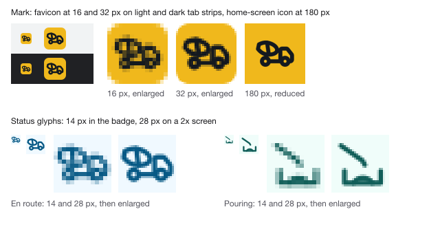

# Design notes

Four visual changes from one craft pass over the sample, each with the reason it is there. The mark, the two
status glyphs, the icons and the link image are made by small Python scripts in `design/` (standard library only)
and exported with the Inkscape command line, so they can be rebuilt and changed like code. The threshold strip is
a React component instead; change 3 says why.



## 1. A mixer truck for the company mark

**What.** A side-on ready-mix truck in dark ink on a yellow tile: the drum tilted rear-up with one spiral fin, the
cab, two wheels. It replaces the yellow "PR" letter tile.

**Where.** The sidebar on `/after` (full and as the icon rail), the header of `/field` and `/field/qc`
(`BrandMark` in `src/components/product-shell.tsx`), the browser tab (`src/app/icon.svg`, `src/app/favicon.ico`)
and the iOS home screen (`src/app/apple-icon.png`). The yellow is the `--brand` token in `src/app/globals.css`.

**Why.** "PR" said nothing about the business, and on an overview that lists "PR 1" to "PR 7" it read as "pull
request". A mixer drum is the one thing every dispatcher, driver and QC tech in ready-mix knows on sight, so the
fictional company reads as a concrete producer at a glance. It is a plain pictogram with no letters, so it can't
be taken for a real producer's livery. The sidebar tile, the favicon and the home-screen icon are one drawing:
the stroke was set to stay solid at 16 px on light and dark tab strips (the sheet above).

## 2. Mixer and chute glyphs in the status badges

**What.** En route now shows the mark's mixer, and Pouring a chute dropping concrete into an open form. They
replace lucide's box van and water drops. The Fleet item in the sidebar and the driver's note on `/field` use the
mixer too.

**Where.** `STATUS_META` in `src/components/dispatch/status.tsx`, so every row and phone card on `/after`, the
order sheet's header and the badge strip on `/standard`. The glyphs live in `src/components/glyphs.ts`.

**Why.** The status badge is the most repeated thing on the board, and rule TB4 makes its icon part of the
meaning. A parcel van and water drops are stand-ins; on a concrete board, water drops even hint at water added on
site, which QC watches for. The labels and colours did not change, so nobody relearns anything. Batching keeps
lucide's factory: a batch-plant drawing did not hold up at 14 px. The glyphs sit on lucide's grid (24 px, 2 px
round strokes) and are made with `createLucideIcon`, so they size, colour and align like the icons next to them.

## 3. The board's risk thresholds on the overview

**What.** Two small scales under the question "How late is late for your customers": minutes behind plan (0 to 4
on plan, 5 to 14 at risk, 15 and over late), and no truck assigned (at risk from 60 minutes before the start). The
caption asks the client to replace the three numbers.

**Where.** `src/components/risk-strip.tsx`, in the week-one questions on `/`.

**Why.** Three numbers decide what lands in the At risk view, the "Orders at risk" tile and the red and amber
lines on the rows, but they only existed in code. Showing the current answer, in the board's own colours and
words, gives the client's dispatchers something concrete to correct on day 1 of the trial, and shows that the
rule is a setting rather than a guess built into the screen. It is a component, not a drawn file: it imports
`LATE_AFTER_MIN`, `SLIPPING_AFTER_MIN` and `NO_TRUCK_WINDOW_MIN` from `src/lib/dispatch/derive.ts`, so it can't
disagree with the board, its labels are live text that wraps on a phone, and screen readers get the rules as one
sentence.

## 4. The link preview image, redrawn

**What.** The 1200 × 630 image that chat apps show for a shared link: the before and after screens side by side
under the title, in the same layout as before.

**Where.** `src/app/opengraph-image.png`, drawn from `public/shots/before.png` and `after.png` (the overview's
two screenshots).

**Why.** The old image, and the overview's After screenshot, still showed the "PR" tile. A link sent to the client
should show the board as it is.

## Left as they were

- The empty states keep an icon in a circle: their copy is specific and the empty day offers Schedule pour, so a
  drawing would only decorate them.
- No illustration on the overview: the strip in change 3 is the one figure that carries information.
- `themeColor` stays `#18181b`: it matches the dark sample bar at the top of every page (now commented).

Also in this pass: the unused dark-mode tokens left from the shadcn template are gone from `globals.css` (the
sample is light only), and four lines of copy were reworded where they read like notes rather than sentences: the
States intro on `/standard`, the intro to "What changed and why", the QC test-plan footnote and the README's Data
section.

## Rebuilding the drawn assets

Needs Python 3 and Inkscape 1.4 (`inkscape` on the PATH, or set `INKSCAPE`). From the repo root:

```bash
design/build.sh
```

| Script | Makes |
| --- | --- |
| `design/glyphs.py` | `src/components/glyphs.ts` (MixerTruck, ChutePour) and the mark's SVG sources. The drum outline is computed: a cone from the open rear to the full diameter, then a domed front, tilted 12° |
| Inkscape | `src/app/icon.svg` (plain SVG), `src/app/apple-icon.png` (180 px, opaque because iOS rounds the corners itself), the 16, 32 and 48 px PNGs |
| `design/favicon_ico.py` | `src/app/favicon.ico` from those three PNGs |
| `design/previews.py` | `design/previews/sizes.png`, the sheet above |
| `design/og_image.py` | `src/app/opengraph-image.png`, through Inkscape |

To change the drawing, edit `design/glyphs.py` and run `design/build.sh`; don't edit `glyphs.ts` by hand. When
the board's look changes, retake the two overview screenshots first, then run the build again:

```bash
pnpm build && pnpm start --port 3301
node design/shots.mjs http://localhost:3301
design/build.sh
```

The link image asks for IBM Plex Sans, the site's face, and falls back to Helvetica Neue or Arial where Plex is not
installed. Plex was not installed where the current image was drawn, so its title is set in Helvetica Neue.
Intermediate files go to `design/out/`, which git ignores.
